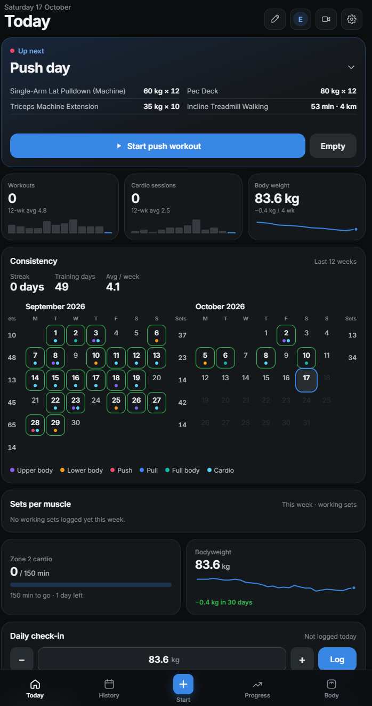
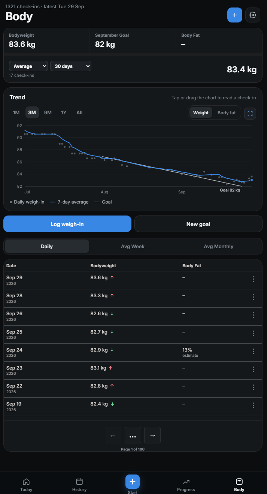
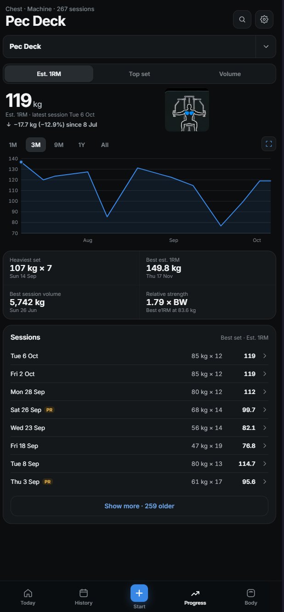
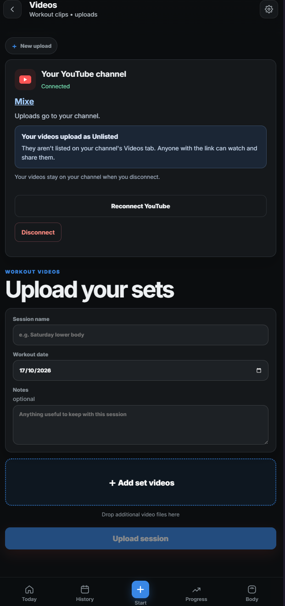

  

<h1 align="center">Gym Logger</h1>

Gym Logger is a mobile-first app for recording workouts and following your progress. Keep strength training, cardio, body measurements and optional workout videos together in one place, with your own account and private training history.

Use it in your browser or add it to your phone's Home Screen for an app-like experience.

## App preview

<table>
  <tr>
    <th width="25%">Today</th>
    <th width="25%">Body</th>
    <th width="25%">Progress</th>
    <th width="25%">Videos</th>
  </tr>
  <tr>
    <td valign="top"></td>
    <td valign="top"></td>
    <td valign="top"></td>
    <td valign="top"></td>
  </tr>
</table>

Your dashboard, body trends, strength progress and workout videos. Select a screenshot to view it full size.

## Your training at a glance

**Today** brings together your weekly activity, training calendar, muscle-group set totals, cardio goal, body-weight trend and recent personal records. It also suggests a next workout based on previous sessions and lets you resume one already in progress.

Customise the dashboard by rearranging cards, hiding sections you do not need and restoring them later. Your layout is saved to your account.

## Log strength workouts

- Choose from the exercise library, save favourites or create your own exercises.
- Record sets, reps, weight and effort (RPE), with warmups, supersets and notes.
- Use previous-session suggestions to pick up where you left off.
- Follow a live rest timer, with optional phone alerts and a reminder if a workout is left running.
- Attach reusable machine photos to remember equipment settings or setups.
- Resume an active workout after returning to the app, then save it to your history.

Choose kilograms or pounds for weight entry and display.

## Review your history and progress

**History** lets you revisit and edit saved workouts, read notes and open machine photos. The training calendar shows your consistency over time.

**Progress** shows per-exercise charts and personal records. A **Weight PR** celebrates a heavier completed working set; a **Volume PR** celebrates more reps in a set at a weight you have used before. You can also follow estimated one-rep max and weekly muscle-group set totals.

Import existing workout set history from CSV, review it before saving, or export your completed sets. Workout CSVs are for set history rather than a full backup of notes, photos, videos and other account data.

## Track cardio and body measurements

**Cardio** records sessions on their own or alongside a workout. Add duration and optional machine or watch metrics such as distance, calories, average heart rate, speed, incline and cycling power. Compare activity across date ranges and work towards a weekly Zone 2 target.

**Body** tracks body weight and optional body-fat measurements, with trends and a weight goal to help you follow changes over time.

## Keep workout videos together

The optional video logger combines individual set clips into one workout video for YouTube. Arrange your clips, follow upload and processing progress, and keep timestamp links for reviewing your technique. Portrait and landscape clips keep their proportions, and phone alerts can let you know when the video is ready.

Video access depends on the administrator's settings. You can use the workout tracker without uploading videos.

Connect your own YouTube channel in **Settings** or **Video logger**. Choose your Google account
and channel, approve access, and confirm the channel shown before uploading. The administrator
configures Google once for the installation; users do not need API keys or credential files.
See [YouTube setup](docs/YOUTUBE-SETUP.md) for the administrator's steps.

## Your account and sharing

Sign in with a username and password, personalise your name and profile photo, and keep your profile **Private** or choose **Friends only** or **Public** sharing within the app's sharing community.

Shared profiles include workouts and your profile photo. You choose separately whether to share machine photos, body measurements, goals, cardio and notes. Friends-only profiles require approval before followers can see your training. Usernames and uploaded videos are not shared through profiles.

Administrators can manage accounts, registration, video access and private app feedback from the admin console.

## Getting started

Sign in or create an account if registration is available. The guided tour introduces the main screens; tap **Start** to log your first workout. In **Settings**, you can replay the guide, find **Add to Home Screen** instructions, adjust training and display preferences, enable phone alerts, and send feedback or feature requests.

For more detail:

- [Release notes](docs/RELEASE-NOTES.md): what has changed in the app.
- [Contributing](CONTRIBUTING.md): how to report issues or help improve it.
- [Technical reference](docs/TECHNICAL-REFERENCE.md): local setup, development checks and administration.
