# Gym Logger release notes

## 0.5.3

This coordinated release includes custom exercise labels (#23), weight and volume records (#24), profile sharing and follow requests (#25), and Home card editing (#26), together with the previously pending guide, feedback and profile-photo improvements. The release is **0.5.3** for the whole batch, as requested; the earlier 0.4.0, 0.4.1 and 0.5.0 proposals were unpublished and are consolidated here.

- Exercises you create show a small **Custom** label under their name in **Select Exercise**, on the exercise card in a workout, and in the **Progress** exercise search. Built-in exercises are unchanged.
- Custom exercises belong to the creator's exercise library. Other accounts cannot find them in their own search, open the creator's personal progress or favorite them, and can still create an exercise with the same name. Exercise names in workouts you choose to share follow your profile-sharing rules.

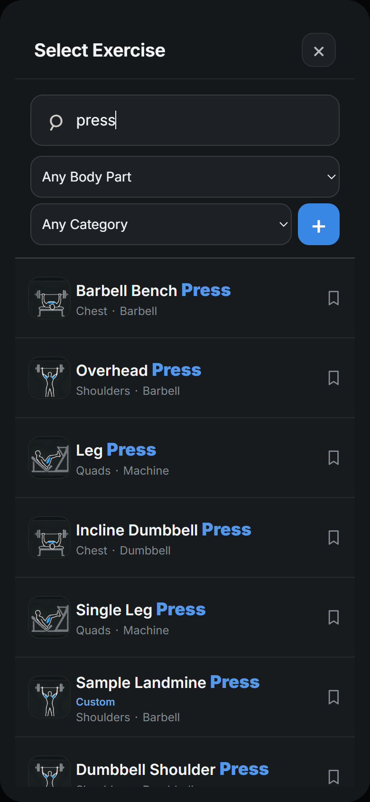

A sample account's custom Landmine Press in the exercise picker, captured at phone width in the isolated verification environment.

- Choose who can see your profile in **Profile > Profile sharing**: **Private** (only you, the default for every account), **Friends only** (followers you approve) or **Public** (every member who shares). Only members who share their own profile can see or follow others.
- **Follow** a public profile straight away, or **Request to follow** a friends-only one. Requests wait under **Follow requests** in **Shared profiles**, where you **Approve** or **Decline** them; **Profile** shows how many are waiting. **Your followers** lists who follows you, with **Remove**. You can cancel a request or **Unfollow** from someone's profile at any time. Making your profile public approves waiting requests.
- Your **workouts** and **profile photo** are always shared with anyone who can see your profile. A friends-only profile shows only its name and photo until you are approved. Choose separately whether to add **Machine photos** (photos pinned to exercises in your shared workouts), **Body weight** (weigh-ins, body fat and body weight logged with sets), **Goals** (your body-weight goal and weekly Zone 2 target), **Cardio sessions** and **Notes** (including saved video links). While private, choices are a draft until you choose **Share with friends** or **Make my profile public**; afterwards each change saves straight away.
- **Shared profiles** lists you, the people you follow, other public profiles, then friends-only profiles to request, with chips for Public, Friends only, Following, Requested and Follows you. Open a profile to see its totals, shared body-weight trend and goal line, goal progress, recent cardio, and workouts in the weekly History cards: read-only, loaded ten at a time, with shared machine photos that open full size.
- Choosing **Private** hides your profile immediately and hides other profiles until you share again. Followers and choices are kept for when you share again. Usernames, videos and sample data are never shared. Disabled and deleted accounts disappear, and administrators get no extra access.
- Existing installations should run `alembic upgrade head` for migration `0033_profile_sharing` before serving the updated frontend. It adds the `profile_sharing` and `profile_follows` tables only. Sharing choices are included in account backups; follows are relationships with other accounts and are not. Both are deleted with the account. No workout records are changed.

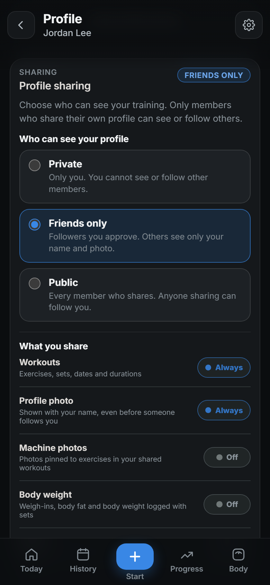

Choose who can see your profile. Workouts and your profile photo are always shared; the rest is optional.

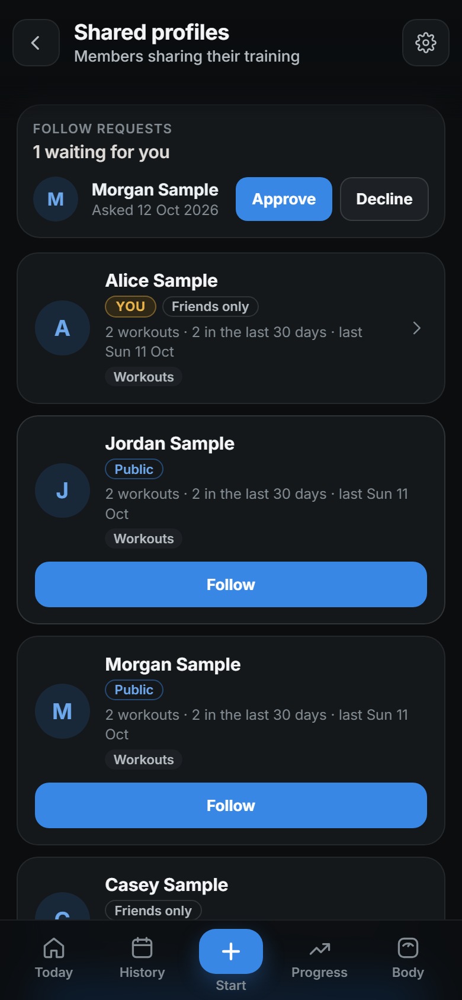

Approve follow requests and follow other members. Friends-only profiles stay locked until their owner approves you.

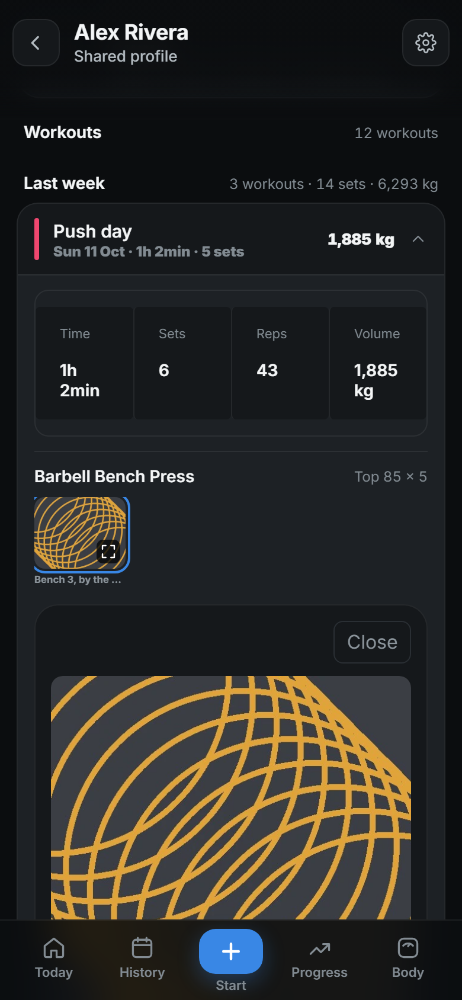

A shared machine photo inside another member's workout. All captures use fictional sample accounts in the isolated mobile verification environment.

- **Weight PR** means a new heavier completed working set for that exercise. **Volume PR** means more reps in one set at the same previously logged weight for that exercise, including zero added weight. Each exercise and weight has its own baseline; first attempts, ties, lower results and extra total sets do not earn a PR.
- A dismissible **five-second** popup names **Volume PR** or **Weight PR**, the exercise, reps and weight when you complete a record set. A blue bar along its bottom counts down to automatic dismissal and starts fresh for each new record. Existing records do not celebrate again when you reopen, toggle or save an unchanged workout. History, Today and Progress use the same two record types.
- Warmups, incomplete sets, zero reps and failed sets below their configured rep target cannot earn records. Drop sets and failed sets that meet their target remain eligible. Kilogram/pound display preferences do not change comparisons. Backdated workouts, edits and deletions rebuild the derived records in date order.
- Estimated 1RM remains available in Progress, but estimated 1RM, duration and distance increases no longer award PRs. Existing derived PRs are recalculated on backend startup; original workout records are preserved. No database migration is required.
- Progress pairs the heaviest set's weight with that same set's reps and RPE, rather than showing a weight/reps combination from different sets. Estimated 1RM remains the best estimate across eligible sets.

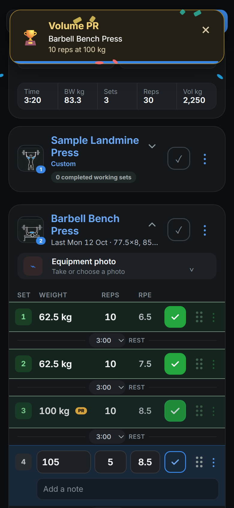

The five-second Volume PR popup with its blue countdown bar and the Custom exercise label in the combined 0.5.3 build. The new 0.5.3 screenshots use fictional accounts and synthetic records on MainPC's isolated 8447 verification route. Earlier guide, sharing-option and machine-photo screenshots are retained from their original feature verification.

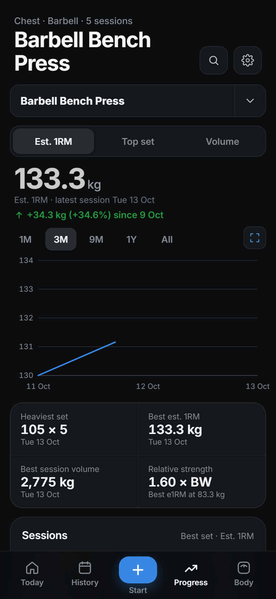

The heaviest-set summary now keeps weight and reps from the same logged set. Captured from the combined 0.5.3 build with synthetic workouts.

- Choose the **pencil icon** on **Today** to arrange the actual Home cards directly. Cards gently wiggle like iOS Home Screen icons, with a **drag handle at the top right** and a **minus button at the top left**. Drag a handle with a mouse or touch, or focus it and use the keyboard arrow keys. Minus hides its card; **Add sections** restores hidden cards in their saved positions. This replaces the separate reorder list. It includes the individual weekly stat boxes, next workout, consistency calendar, muscle sets, cardio goal, bodyweight trend, daily check-in and recent records. Card actions are disabled while editing, and both system and in-app reduced-motion settings turn off the wiggle.
- **Save layout** keeps the arrangement in your account across devices and sign-ins. **Cancel** discards edits, and **Reset layout** restores the original order with every section visible before saving. Save failures keep your edits for retry. An active workout's **Resume** card always stays visible even when the next-workout section is hidden. Hiding cards does not delete data or remove the other navigation tabs. Layout preferences use existing account settings and backups; no database migration is required.
- The **History** calendar header no longer shows "Sets per week · swipe for earlier months". Month scrolling and weekly set totals remain available.

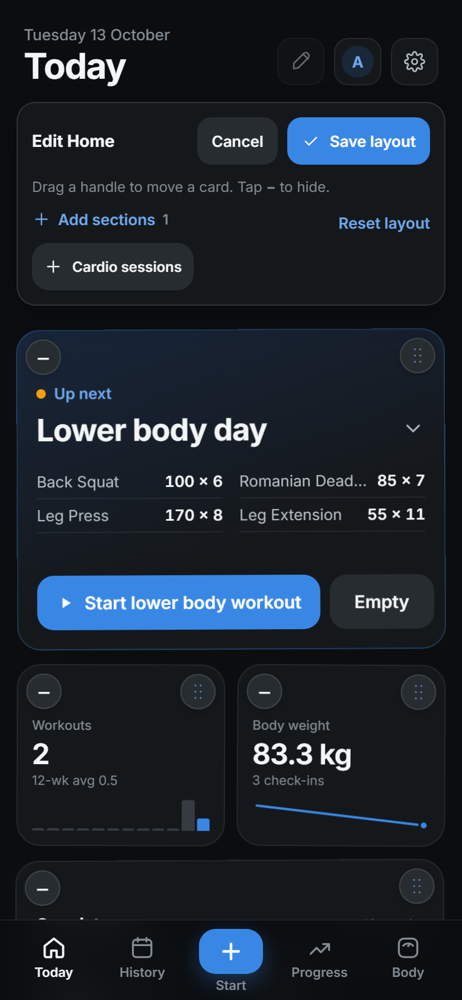

Arrange the cards directly while they gently wiggle, and restore hidden cards from Add sections. Captured with an isolated sample account at phone width; the wiggle respects reduced-motion settings.

- New accounts get a feature tour after closing **What's new**. Annotations highlight the real Today, Start, History, Progress, Body and Cardio controls, plus Videos when the account has access. Move with **Next** and **Back**, or **Skip guide** at any time. The tour does not start workouts or uploads.
- Choose **Show steps** after **Make Gym Logger your own** to see the illustrated Home Screen installation page, then **Next** for the thank-you message and optional feedback box. **Back** returns to the feature tour; **Skip guide** remains available. **Send feedback** stores your message privately with your username for administrators to read in **Settings > Admin console > App feedback**. Failed submissions keep your text for retry; retrying the same submission does not create duplicates.
- **Settings > Feedback & feature requests** provides a dedicated form at any time, with **Send another message** after a successful submission. Both this form and the tour explain where messages go: the app's database and private administrator inbox, with your username. Messages are not emailed or posted as GitHub issues.
- **Settings > App guide > Replay guide** starts the tour again. Dismissal is remembered per account/browser, including when using the installed app.
- **Settings > Add to Home Screen > Show steps** opens the illustrated Safari instructions (menu, Share, View More, Add to Home Screen, Add), plus Android Chrome instructions. The illustrations use **gym-logger.duckdns.org** and link to the public app address. This remains available in the installed app to help set up another device.
- Open **Settings** from the top-right button on Today, History, Progress, Body and Cardio, and from the profile, video and admin screens.
- The suggested next workout starts with its explanation and last-session details collapsed. Select the arrow beside the workout title to show or hide them; exercises and Start remain visible.
- The closing screen and Settings link to the GitHub repository and contribution instructions. Contributions use focused branches, sample data, project checks, accessible controls and reviewed UI evidence.
- The tour waits behind release announcements, loading, active workout/upload screens and other dialogs. Older queued installation guides still work; new accounts use the feature tour and can open installation steps from Settings.
- Add a **profile photo** in **Profile**. Choose any JPEG, PNG, WebP, HEIF or HEIC image; Gym Logger rotates it upright and crops it to a square. The photo replaces your initial on the **Today** profile button and in Profile. **Change photo** replaces it and **Remove** goes back to your initial. Photos are private by default and can be shared through Profile sharing. They follow the existing photo upload size limit, are included in account backups and are deleted with the account.
- Release announcements support screenshots that open full size and remain usable when images cannot load.
- Existing installations should run `alembic upgrade head` for migrations `0031_app_feedback` and `0032_profile_photos` before serving the updated frontend. Feedback is removed when its account is deleted. Profile photo files are stored under `data/profile-photos/`. No account/workout records are changed by these migrations.

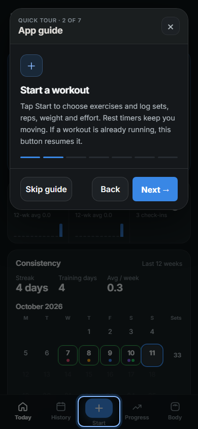

The feature tour points to the actual controls. Captured at phone width with isolated sample workouts.

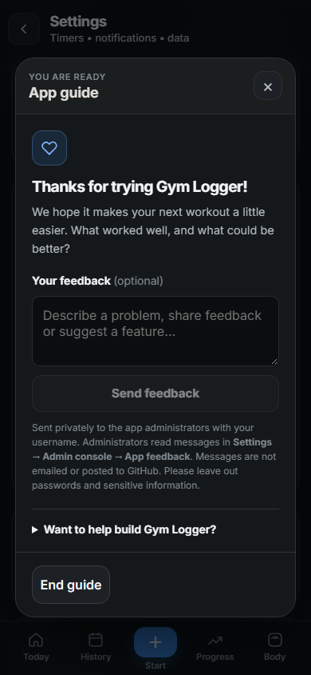

The final screen invites feedback and contributions.

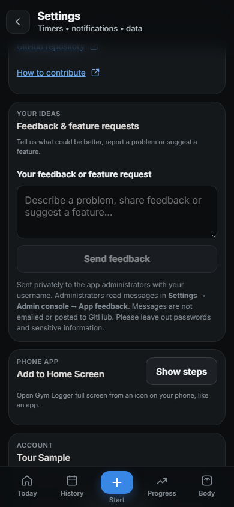

Send ideas from Settings without replaying the tour. The form states who receives messages and where administrators can read them.

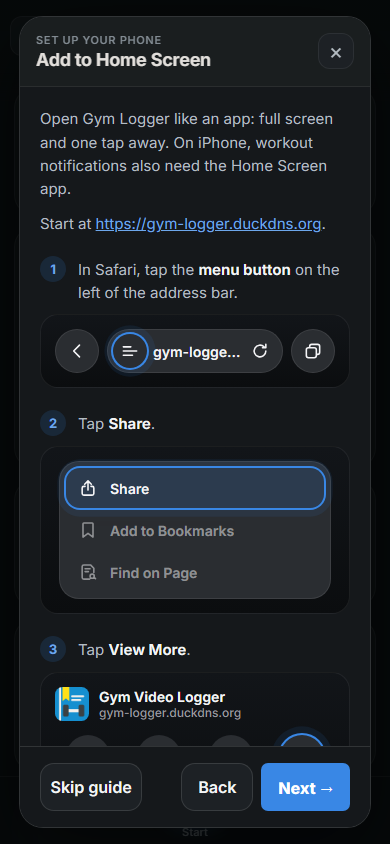

After the final feature annotation, **Show steps** opens installation help before the thank-you screen. The public app address appears in the instructions and illustrations.

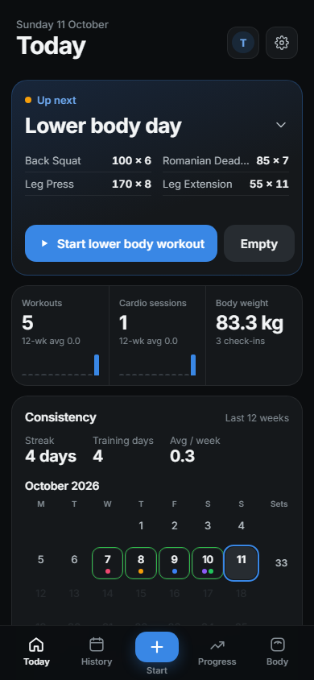

Workout details start collapsed; the arrow expands them. Settings is available across tabs. All captures use isolated sample records. [Watch the short tour recording](screenshots/releases/0.4.0-app-guide.webm) to see the feature annotations, installation before feedback, a sample feedback submission, the dedicated Settings feedback section and the workout dropdown.

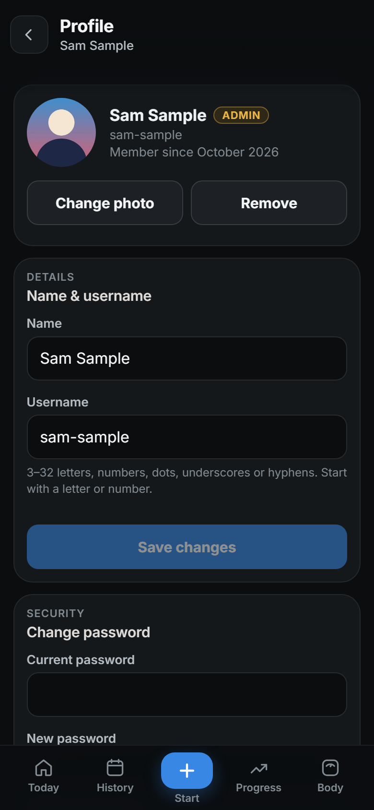

A sample account's profile photo in the isolated mobile verification environment.

## 0.3.1

- The **What's new** pop-up can show a screenshot alongside the release notes. Select it to view the image full size.
- Screenshots include descriptive text and scale to fit mobile screens. If an image cannot load, the notes, GitHub link and dismissal controls remain available.
- Release screenshots are stored with the GitHub notes; the announcement uses a direct image URL pinned to the screenshot's commit. Releases without a screenshot continue to work.

The illustrated announcement in the isolated mobile verification environment, using the [username signup screenshot](screenshots/releases/0.3.0-username-signup.png) as an example.

## 0.3.0

- Create accounts and sign in with a **username and password**. Account emails are no longer collected or stored in the active users table.
- Usernames ignore letter case and use 3–32 ASCII letters, numbers, dots, underscores or hyphens, starting with a letter or number. The separate display name remains available.
- Profile, the admin console, account backup metadata and administrative commands now identify accounts by username. CLI commands use `--username` instead of `--email`.
- Existing accounts keep their IDs, passwords, sessions, preferences and workout history. Migration `0030_username_accounts` assigns usernames from the part of the old email before `@`, sanitizes unsupported characters and adds numeric suffixes for collisions. Short or unusable names become `user`. Administrators can run `python -m app.manage list-users` to see assignments.
- Invite codes, registration controls and push notifications continue to work. The server's Web Push contact mailbox is separate from accounts and stays configured.
- New account backup manifests use format 2 with an owner username. Existing backup archives are preserved. Because old account emails are removed, rollback requires the pre-update database backup and previous application version.

Username-based account creation in v0.3.0, captured with empty fields in the isolated verification environment.

## 0.2.0

- A **What's new** pop-up shows the deployed version, a short list of changes and a link to these GitHub notes when you sign in, reopen the app or reconnect after an update.
- Dismiss a version once per account and browser. Later releases appear automatically; local and production addresses remember dismissal independently. First-time users see the current release too.
- Open **Settings → What's new → View changes** to read the announcement again, including during local development.
- Announcements wait while the workout or video upload screen is open, and while the app is loading or showing a completion/message dialog.

## Publishing the next announcement

1. Edit `frontend/release.json`. Choose the version manually following [the agent release policy](../AGENTS.md#release-versions-and-announcements). Before merging a batch, [evaluate the currently open GitHub PRs](../AGENTS.md#reviewing-and-merging-a-pr-batch), select the included PRs and reconcile their release metadata. A coordinated batch of multiple PRs for an application release gets **one minor bump** (`0.3.0` to `0.4.0`), even if its changes are mostly patches. Every PR in that batch shares the version and contributes to one announcement; do not accumulate its individual version proposals. Reuse an already pending minor release for that batch, consolidate unpublished patch notes into it, and retain the version for follow-up fixes before deployment. For an independently released single PR, default to a patch (`0.3.0` to `0.3.1`); a substantial new capability can justify a minor bump. Documentation/test/tooling-only batches with no application behavior change need no app bump. Compare deployed and pending versions, never reuse a deployed number, and preserve deployed release history. Update `title`, `summary`, `changes` and `url`. `url` must be an HTTPS GitHub link to your release, changelog or pull request. The build validates the metadata but does not increment versions automatically.
2. Add the detailed notes here (keep previous versions), or publish a GitHub release and link to it instead. If this repository is private, readers need GitHub access to open that link; the short notes remain visible inside the app.
   For a visible feature or UI improvement, include a screenshot of the verified revision using isolated sample data. Inspect it for private information, commit it under `docs/screenshots/releases/` with a versioned filename, and embed it here using a relative image path, descriptive alt text and a caption. Before/after images are useful when they clarify the change. Explain omitted screenshots in the notes or pull request when capture is unavailable or the change has no visible result.
   The optional `image` object in `frontend/release.json` uses `url` and `alt` to display the same screenshot in the app's pop-up. Use a direct HTTPS `raw.githubusercontent.com` image URL pinned to the screenshot's commit, not a GitHub page URL or temporary browser-artifact path. Check anonymous access before publishing; private-repository images may not be accessible to app users. If the image is unavailable, the app still shows the text and dismissal controls.
3. Test the feature and announcement locally. Dismissal is remembered for each version; **View changes** always reopens the dialog without clearing browser data.
4. Commit and push the code and metadata, merge to the VM's deployment branch, then run the existing VM update procedure. It pulls, builds the frontend and restarts the backend. A bare `git pull` does not rebuild `frontend/dist`.

Vite emits `release.json` into `frontend/dist` with the app and serves it directly during development. The browser checks that deployed file using `cache: no-store`; the service worker does not precache it. The announcement therefore follows the build being served, including when building on a PC and copying the complete `dist` to the VM. Changing source notes without deploying a new frontend build leaves the production announcement unchanged.

If users miss several releases, they see the latest summary and can follow the link for earlier notes. Network failures leave the app usable and are retried when it returns to the foreground or reconnects. Dismissal survives sign-out; deleting browser storage shows the notes again. Browsers that block storage remember dismissal for the current page session only.
