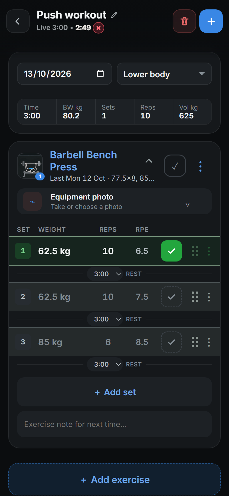
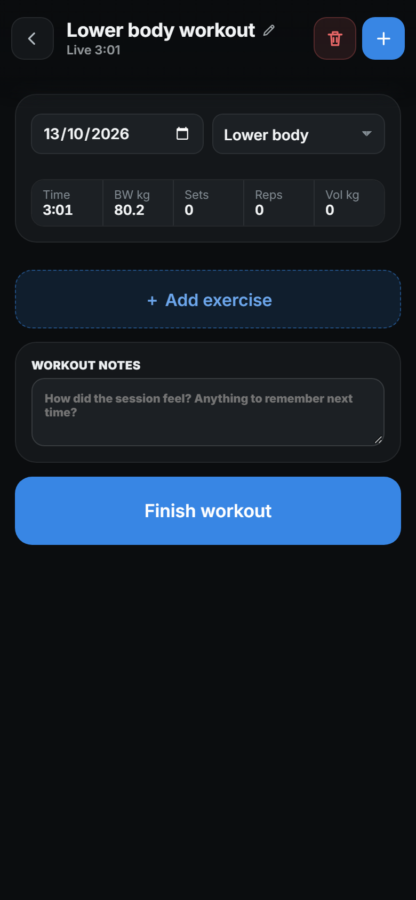
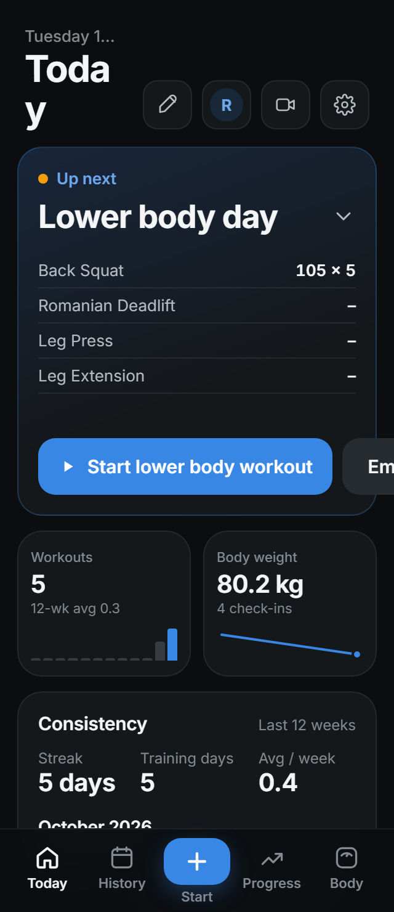
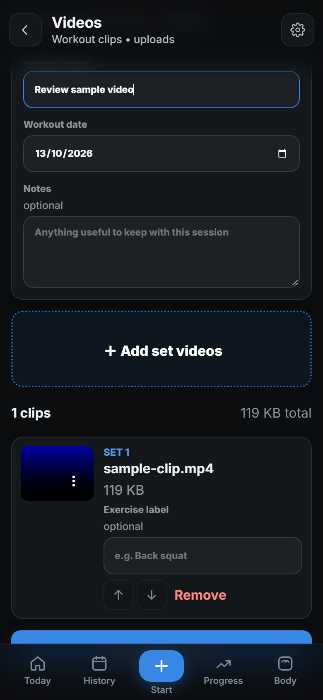

# Gym Logger — comprehensive user review

Reviewed 13 October 2026. Release **0.5.3**, latest GitHub `master` at **fbe86723b5b4e8bc5f077901e06807f6c6917f3a**.

This is the historical review of that pinned revision. Track subsequent work in
[the GitHub review index](https://github.com/ejbolts/Gym-video-logger/issues/29).
Recheck findings against the current code before implementing them.

| P1 finding | Tracking issue |
| --- | --- |
| F01: active workout recovery | [#30](https://github.com/ejbolts/Gym-video-logger/issues/30) |
| F02: untouched suggestions on inactivity | [#31](https://github.com/ejbolts/Gym-video-logger/issues/31) |
| F03: consistent weight units | [#32](https://github.com/ejbolts/Gym-video-logger/issues/32) |
| F04: accurate CSV export coverage | [#33](https://github.com/ejbolts/Gym-video-logger/issues/33) |
| F05: safe CSV import review and session identity | [#34](https://github.com/ejbolts/Gym-video-logger/issues/34) |

The immediate F04 fix is truthful export coverage and a link to existing account-snapshot
instructions. A new archive/restore UI and general Undo import remain roadmap additions.
The P2/P3 findings and feature roadmap remain available for subsequent agent review.

## Overall assessment

Gym Logger has a useful and unusually broad foundation for a private training app. The core screens have a consistent visual style, workout entry includes previous sets, RPE, rest timers and PR feedback, and History connects well to exercise progress. Machine photos, optional video processing, detailed cardio metrics and granular profile sharing give it a distinct purpose.

The next investment should be **trust and speed during a workout**. I reproduced loss of active workout sets after a reload and automatic logging of untouched suggestions after a timeout. Those affect the accuracy of the user's training record. Fix those before expanding the feature set. After that, the highest-value additions are explicit saved routines, dependable offline saving, an exercise library manager and safe import/backup flows.

This is a user review with supporting code inspection, not a security audit or a claim that every device/platform has been tested. Priorities below mean: **P1** fix before the next feature release, **P2** next usability/reliability iteration, **P3** later polish. Effort estimates are relative scope, not delivery promises.

## What was actually reviewed

- Fetched the attached `origin` repository, inspected branches/upstreams/worktrees and all open PRs. There were **no open PRs**. The original checkout was an older feature branch; the review used a separate, fresh detached worktree instead of changing that branch. A final fetch confirmed the reviewed commit still matched `origin/master`.
- Built the production frontend and exercised registration, release announcement/tour, Home, layout hiding and persistence, suggested workouts, exercise selection, set editing/completion, rest timers, PR feedback, workout completion, History, exercise progress/fullscreen, body check-ins, cardio entry, sharing settings/directory, Settings, Admin and a mock video upload.
- Reviewed **390 × 844**, **320 × 740** and **1280 × 900** layouts. These are desktop-browser viewport sizes; they do not reproduce a phone's keyboard, Safari, OS notifications or background suspension.
- Simulated an API connection failure during workout saving. The draft remained available and a manual retry succeeded. Simulated four hours elapsed to exercise the real inactivity handler; this was a clock simulation, not a four-hour endurance test.
- **Production build passed; 370 frontend tests and 274 backend tests passed.** Passing tests did not catch the browser reload failure. One autosave test expressly endorses completing previous-set suggestions, so that behavior also needs a product decision and changed acceptance criteria.

The browser review ran on **MainPC**, private HTTPS **8447 → loopback 8001**, using an isolated database, generated sample accounts/data, separate session cookie and push-key path, and YouTube mock mode. The review used a separate checkout of the pinned revision. No application source was changed. The stable app, real records, uploads and credentials were preserved. No PR, push, deployment or release bump was needed for this analysis/artifact task.

## Findings to fix first

### F01 — Reload can erase an active workout's exercises and completed sets — P1

**Browser reproduced repeatedly, supported by code.** I added Barbell Bench Press, completed one set at **62.5 kg × 10**, and confirmed the stored draft contained the movement and completed set. A full reload kept the live timer but displayed **0 sets**, removed the exercise and overwrote the stored draft with `movements: []`. This concerns an unfinished local workout, not previously saved server workouts.

The likely cause is a startup ordering problem: exercise data is committed through a React transition while loading is cleared immediately. The logger can initialize against an empty exercise list, discard unresolved draft exercise IDs, then persist the empty result. Failed catalogue loading exposes the same code path. This cause is strongly supported by inspection; the exact scheduler timing was not instrumented.

**Change:** restore the draft only when required catalogue data is ready, preserve unresolved movements, and prohibit writing an empty restoration over the original draft. Keep a recoverable copy until restoration succeeds.

**Acceptance:** a populated draft survives ordinary reload, delayed/failed catalogue loading, returning from background and app updates; completed sets, notes, exercise IDs and elapsed time remain intact.

Source: [startup updates](https://github.com/ejbolts/Gym-video-logger/blob/fbe86723b5b4e8bc5f077901e06807f6c6917f3a/frontend/src/App.tsx#L626), [draft restoration](https://github.com/ejbolts/Gym-video-logger/blob/fbe86723b5b4e8bc5f077901e06807f6c6917f3a/frontend/src/App.tsx#L1935), [draft persistence](https://github.com/ejbolts/Gym-video-logger/blob/fbe86723b5b4e8bc5f077901e06807f6c6917f3a/frontend/src/App.tsx#L2062).

| Before reload | After reload |
| --- | --- |
|  |  |

### F02 — Inactivity can turn untouched suggestions into recorded training — P1

**Browser reproduced with a simulated clock.** Three sets copied from the previous bench session were still unchecked and untouched. Advancing the browser clock and triggering the inactivity handler saved a **3-hour workout with 3 completed sets and 1,755 kg of volume**. That training had never been confirmed by the user.

**Change:** distinguish planned/suggested sets from performed sets. Untouched suggestions should never contribute completed sets, volume, PRs or muscle totals. Preserve genuinely entered but unchecked data as a draft or make its treatment explicit in a recovery summary. Explain the timeout before it happens.

**Acceptance:** zero confirmed/entered sets create no performed workout; one completed set beside two untouched suggestions records exactly one set. Handle interrupted saves without repeating the workout.

Source: [autosave eligibility](https://github.com/ejbolts/Gym-video-logger/blob/fbe86723b5b4e8bc5f077901e06807f6c6917f3a/frontend/src/workoutAutoSave.ts#L5), [expiry save](https://github.com/ejbolts/Gym-video-logger/blob/fbe86723b5b4e8bc5f077901e06807f6c6917f3a/frontend/src/App.tsx#L2511), [current test expectation](https://github.com/ejbolts/Gym-video-logger/blob/fbe86723b5b4e8bc5f077901e06807f6c6917f3a/frontend/src/workoutAutoSave.test.ts#L25).

### F03 — The Pounds preference is inconsistent — P1

**Browser reproduced.** Settings says the weight unit applies throughout the app. Selecting Pounds changed Home PR cards to pounds, while workout entry, workout totals, Home body weight and body measurement entry continued to use kilograms. Progress also displays kilogram metrics. A user can reasonably expect the input unit to follow the setting.

**Change:** apply one conversion/formatting policy to entry, history, progress, body, goals and sharing, while retaining kilograms internally. State any export-format unit independently. If that scope is deferred, narrow the preference's description to its actual effect.

**Acceptance:** toggling kg/lb changes labels and values consistently; entering a value in pounds stores the correct kg amount and round-trips without unintended changes.

Source: [preference wording](https://github.com/ejbolts/Gym-video-logger/blob/fbe86723b5b4e8bc5f077901e06807f6c6917f3a/frontend/src/App.tsx#L6173), [kg workout input](https://github.com/ejbolts/Gym-video-logger/blob/fbe86723b5b4e8bc5f077901e06807f6c6917f3a/frontend/src/App.tsx#L3925).

### F04 — CSV is described as a full backup, but loses important information — P1

**UI observed and format confirmed in code.** Settings says “All time creates a full backup.” The workout export has nine columns covering date, exercise, kg/lb, reps, body weight, percentile and warmup. It cannot preserve workout identity/name, separate sessions on one date, RPE, rest, duration, notes, photos, supersets, goals or the complete video/account record. There is already a richer per-account snapshot implementation available through the CLI.

**Change:** call CSV a workout data export and list its coverage. Add a separate account archive/download and a validated restore flow, with explicit treatment of original videos, credentials and relationships.

**Acceptance:** a complete archive round-trips the promised fields and files; a CSV never promises full restoration.

Source: [backup claim](https://github.com/ejbolts/Gym-video-logger/blob/fbe86723b5b4e8bc5f077901e06807f6c6917f3a/frontend/src/App.tsx#L6381), [CSV headers](https://github.com/ejbolts/Gym-video-logger/blob/fbe86723b5b4e8bc5f077901e06807f6c6917f3a/backend/app/tracker_csv.py#L30), [existing account snapshots](https://github.com/ejbolts/Gym-video-logger/blob/fbe86723b5b4e8bc5f077901e06807f6c6917f3a/backend/app/account_backups.py#L1).

### F05 — Imports need preview, duplicate detection and session identity — P1

**Code-confirmed; duplicate import was not performed in the browser.** Choosing a CSV immediately imports it. The importer constructs new workouts on each run and groups all rows by date. Re-importing a file can duplicate history; morning/evening workouts on the same date collapse into one imported session. There is no review step for exercise mappings, warnings or the number of records about to be added.

**Change:** preview before committing, retain session IDs where available, flag duplicates, let users map exercise names and offer Undo import. Clearly explain the older CSV format's limitations.

Source: [file-selection import](https://github.com/ejbolts/Gym-video-logger/blob/fbe86723b5b4e8bc5f077901e06807f6c6917f3a/frontend/src/App.tsx#L6395), [creation/grouping](https://github.com/ejbolts/Gym-video-logger/blob/fbe86723b5b4e8bc5f077901e06807f6c6917f3a/backend/app/tracker_csv.py#L272).

## Usability and presentation

| Finding | User impact and recommended change | Evidence / priority |
| --- | --- | --- |
| **F06: sample data looks personal on Home** | A new account immediately shows 83.3 kg, recent PRs, workouts and a four-day streak without a Home demo label. History and Body rows label samples, but Home recommendations and totals incorporate them. Offer “Explore a demo” or “Start with my data”; show a persistent demo banner and a clear action to remove all samples. | Browser observed; **P2** |
| **F07: onboarding is too much before the first set** | A long release announcement precedes an eight-step admin tour that also offers installation/help screens. Returning users need release notes; first-time users need a short path to log one workout. Lead with three essentials and make the full tour optional. | Browser observed; **P2** |
| **F08: routine success feedback blocks navigation** | CSV export and autosave use a modal titled “Notification” with OK. Prefer a toast/status for successful actions and reserve a dialog for choices, destructive actions or recoverable errors. Keep accessible live announcements. | Browser observed; **P2** |
| **F09: the smallest phone layout clips controls** | At 320 px, “Today” wraps onto two lines, the date truncates and the secondary Empty button extends beyond the card. Stack the actions and move secondary header controls into a menu. At 390 px the normal layout is much better. | Browser observed; **P2** |
| **F10: video submit overlaps the fixed navigation** | With one clip at 390 × 844, the Upload session button's middle was behind the bottom bar. Clicking its visible upper strip started processing and the mock video completed. Reserve space for the full bar and safe area; verify every screen's last action remains reachable. | Browser observed; **P2** |
| **F11: “fat burnt” overstates the cardio data** | The sample's 150 kcal became “≈ 19 g fat burnt” using kcal ÷ 7,700. This is an energy equivalent, not a measurement of body-fat loss. Rename it “Fat-energy equivalent” with the qualification beside the number, or omit the conversion. | Browser + code; **P2** |
| **F12: exercise filters do not combine as expected** | “Body part” offers Push/Pull/Lower categories, the two dropdowns use one filter state, and entering a search bypasses category filtering. Rename the first filter, keep independent state and apply search within both selected filters. | Code-confirmed; **P2** |
| **F13: long workouts create a lot of scrolling** | Each movement includes equipment photos, a rest control after each set, notes and several actions. Keep those capabilities, but add a compact logging mode with the current exercise/set emphasized and optional fields collapsed. Rename “Empty” to “Start empty workout.” | Browser/design assessment; **P2** |
| **F14: important metrics need short explanations** | RPE, estimated 1RM, effective sets, weekly-best chart aggregation and MET-minutes need plain-language help. The app already identifies estimates and offers useful detail; add contextual explanations without forcing a tour. A daily streak can also be a poor training motivator when rest days are planned; offer a weekly-consistency target. | Browser/design assessment; **P3** |

The calorie wording recommendation is consistent with the limitations of fixed energy-to-weight conversions discussed by [Hall's research](https://pmc.ncbi.nlm.nih.gov/articles/PMC2376744/). This review makes no individual weight-loss prediction.

## Reliability, offline use and accessibility

**Offline saving needs an explicit contract.** In a simulated API failure, Finish workout displayed the raw message “Failed to fetch.” The completed set stayed in the local draft and a manual retry succeeded, which is useful. There was no durable queued-save status or automatic completed-workout sync in this flow. Say “Saved on this device; waiting to sync” when that is true, show unsynced counts and distinguish local persistence from server acknowledgement. F01 must be fixed first, otherwise reopening the local draft is unsafe. A real flight-mode/PWA restart test remains outstanding.

**F15 — stale devices can overwrite newer edits — P2, code-confirmed exposure.** Training data refreshes at startup and after local mutations, while editing/resuming submits the complete cached workout. The server replaces its movements without comparing the version that the editor loaded. Two devices editing the same record can overwrite one another. Add revision checks, a conflict screen and refresh on return when no unsaved edit is active. This scenario was not browser-reproduced. [Save path](https://github.com/ejbolts/Gym-video-logger/blob/fbe86723b5b4e8bc5f077901e06807f6c6917f3a/frontend/src/App.tsx#L757), [update endpoint](https://github.com/ejbolts/Gym-video-logger/blob/fbe86723b5b4e8bc5f077901e06807f6c6917f3a/backend/app/tracker.py#L1593).

**F16 — a lost save acknowledgement can cause duplicates — P2, conditional code risk.** A new workout POST has no client operation ID. If the server commits but the reply is lost, the draft remains and a retry can create another workout. Use an idempotency key for each logical save and reconcile before retrying. Verify by dropping the response after commit, then retrying; only one record should exist. This network timing was not reproduced. [Create request](https://github.com/ejbolts/Gym-video-logger/blob/fbe86723b5b4e8bc5f077901e06807f6c6917f3a/frontend/src/api.ts#L421).

**F17 — some failures are hidden or unactionable — P2.** A failed followers/request fetch is silently ignored, so an unavailable list can look empty. Some account-limit failures intentionally use a generic “couldn't be saved” message. Give users a safe, actionable recovery step without exposing security-sensitive internals; administrative storage controls are already useful. [Sharing fetch](https://github.com/ejbolts/Gym-video-logger/blob/fbe86723b5b4e8bc5f077901e06807f6c6917f3a/frontend/src/SharedProfiles.tsx#L232), [limit messages](https://github.com/ejbolts/Gym-video-logger/blob/fbe86723b5b4e8bc5f077901e06807f6c6917f3a/backend/app/account_limits.py#L39).

**Accessibility foundation is positive, with targeted work still needed.** The app uses semantic buttons, labelled fields, native modal dialogs, keyboard controls for charts/Home ordering and a reduced-motion preference. Some set actions are very small: the menu measured about 18 × 35 CSS px and drag handles about 30 × 34. Increase high-frequency touch targets toward 44 px, verify focus return and screen-reader announcements, and test enlarged text. This is a usability recommendation, not a conformance verdict: [WCAG's target-size criterion](https://www.w3.org/WAI/WCAG22/Understanding/target-size-minimum/) has spacing and other exceptions. Charts should retain a readable tabular/session alternative and never rely solely on category colors. The existing History/session lists are a useful base.

## New features worth adding

| Order | Addition | Why it earns its place | Relative scope |
| --- | --- | --- | --- |
| **1** | **Named routines and a simple schedule** | Save deliberate exercise order, set counts, rep ranges and rest defaults, with “Start routine” and “Save this workout as a routine.” Existing next-session templates derive from the latest category workout; an unusual or partial session should not unintentionally redefine the user's plan. Add optional next-session targets after routine basics. | Medium |
| **2** | **Dependable offline completion and sync** | Gyms have poor reception. Queue completed workouts on-device, show saved/sync states, retry safely and handle conflicts. Support app reopening and explicit recovery. | Large |
| **3** | **Exercise library management** | Rename/correct custom exercises, archive unused entries and merge duplicates without losing history. Existing creation, favourites and machine photos should be preserved. | Medium |
| **4** | **Import review and real account archives** | Preview imports, deduplicate, map exercises and undo a batch. Add complete archive download/restore around the existing snapshot capability. | Medium–large |
| **5** | **A richer workout summary and weekly review** | Show performed sets, duration, PRs, notes and changes from the last comparable session; make sharing/export optional. Give users a clear answer to “what changed this week?” while excluding demo and unperformed sets. | Medium |
| **6** | **Better video-to-workout controls** | Keep existing automatic timestamp links in movement notes, and add explicit workout/exercise selection, clear linking status and technique comparison. Show trimming before processing and add resumable uploads for larger mobile batches. | Medium for linking; large for resumable uploads |
| **7** | **Account recovery and device sessions** | Offer safe recovery codes or a clear admin recovery request, show signed-in devices and allow signing out other sessions. Username-only accounts currently rely on an administrator's CLI password reset. | Medium |
| **8** | **Sharing preview and discovery controls** | Preview exactly what a follower sees, search by display name, filter Following/Discover and paginate. Add a persistent block action if a wider community is intended; removing a follower currently allows another request. | Medium |

Routines and offline logging are established expectations in workout apps; [Hevy's feature documentation](https://www.hevyapp.com/features/) and [routine guide](https://help.hevyapp.com/hc/en-us/articles/34953606698903-Build-a-Workout-Program-Create-Organize-Routines) provide useful reference patterns. The ordering above is based on this app's observed gaps, not a recommendation to adopt another service.

Later candidates: a plate calculator, optional warmup builder, machine setup fields (seat/pin/handle) beside photos, exercise substitutions, rep-range goals and optional planned-rest-day-aware consistency. Avoid launching many of these together; first measure whether the main workout can be logged comfortably with one hand.

## What to preserve

- The dark theme, readable primary actions, clear completed-set state and stable bottom navigation.
- Previous-session context, per-set RPE/notes/rest, supersets, undo for set deletion and the existing PR distinction.
- History editing/resuming, exercise session links, useful progress metrics and fullscreen exploration.
- Body trend/goal tracking, optional cardio measurements and screenshot-import review rather than blindly trusting OCR.
- Private sharing by default, optional sharing fields, follow approvals and exclusion of sample data from shared profiles.
- Machine photos and automatic workout-video timestamp linking, which address real gym-specific needs.
- Admin controls, private feedback, session isolation and substantial automated coverage.

## Suggested delivery sequence

1. **Trust pass:** F01/F02, consistent units, truthful backup wording, import safeguards. Add browser acceptance checks for recovery and data integrity.
2. **Friction pass:** mobile/header/footer fixes, demo onboarding, non-blocking success feedback, correct exercise filters and clearer metric labels.
3. **Daily-use capability:** explicit routines and offline completion, with safe retry and stale-edit conflict handling.
4. **Growth pass:** library management, richer summaries, account/session controls and improved video/sharing workflows.

If the first implementation is deliberately narrow, choose **active draft recovery + untouched-suggestion handling**. Together they protect the app's main purpose: keeping an accurate workout record.

## Limits and evidence

Not directly verified: multi-account follow/approval interaction in the browser (covered by backend tests), installed iPhone/Android behavior, OS push delivery, phone camera/HEIC behavior, OCR accuracy on a real watch screenshot, multi-device conflict execution, large interrupted uploads, real YouTube authentication/processing and long-history rendering performance. The mock video confirmed local selection/upload/processing/completion; it does not validate Google's service. All screenshots show generated sample content.

Evidence files: [phone Home](assets/home-phone.png), [desktop Home](assets/home-desktop.png), [release onboarding](assets/onboarding.png), [reload before](assets/workout-before-reload.png), [reload after](assets/workout-after-reload.png), [small phone](assets/home-small-phone.png), [video action](assets/video-submit-obscured.png), [mock completion](assets/video-complete.png).

This report records recommendations only. Application source and release metadata are unchanged.
